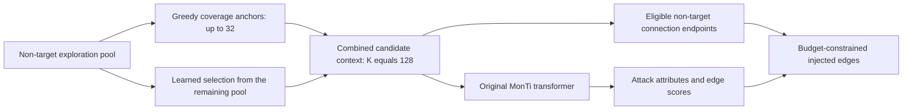

# Full improvement evaluation: draft for owner confirmation

**On hold, 2026-10-30:** the owner requires improvement ideas to follow analysis of actual experimental outcomes. This earlier coverage proposal is retained as an exploration record. Its six-run matrix is not authorized to launch; the next active step is results-first diagnosis of saved training/validation evidence.

Status: no full improvement run has started. The owner requested confirmation of the reproduction conclusion, improvement direction, complete experimental protocol, and final freeze. This document makes the proposed next phase reviewable; it does not record course approval or completed human checks.

## Evidence motivating the proposal

The frozen baseline comparison is complete: learned MR 43.7280% and random MR 40.1902%, with a mean paired difference of 3.5378pp and a 95% interval of [-1.5415, 8.6171]. Its pre-registered conclusion remains **inconclusive**.

Nine training/GCN-validation-only pilots completed and passed independent prediction, configuration, subset, checkpoint, sampling-trace, and cost audits. Coverage candidates had a mean paired validation gain of -0.1833pp; size-proportional sampling had -0.5500pp. Both observed means are negative. The rule frozen before the pilots selects coverage, including when both ideas lose. These pilot scores are not GAGA test improvements.

## Proposed extension and mechanism control

Test whether selecting a few candidates adjacent to different targets provides complementary generation context and potential non-target connection options, improving transfer to the fixed GAGA victim.

The original selector already includes beta, the number of connected targets, as a per-candidate feature. The proposed extension adds an explicit selected-set coverage preference. For example, three candidates may each have beta=2, but two neighbor the same targetsA/B while another neighborsC/D. Counts alone do not identify that overlap. This illustrative example motivates the objective; it is not a claim that the learned selector always makes that choice or cannot encode useful structural information implicitly.

- **Coverage:** keep K=128. For an exploration pool larger than K, greedily reserve at most32 candidates adjacent to previously uncovered target nodes; stop when coverage gain is zero and break ties by global node ID. Fill the remaining slots using the original learned straight-through selector.
- **Matched random-anchor control:** compute the same group's greedy anchor count, then reserve that number of uniformly sampled candidates instead. Fill the remaining slots using the same learned selector. Resample random anchors at each training/evaluation forward, using the registered run seed.
- **Frozen learned baseline:** reuse the already completed seeds0/1/2. It removes the anchor mechanism entirely, with the original learned selection and no new baseline tuning or reruns.

All three retain the same candidate cap, model parameter structure, full graph, fixed detectors, node/edge budget function, feature bounds, loss, optimizer, and checkpoint rule. Small exploration pools are kept in full. The anchors provide constant gates while learned complement gates retain gradients. The random control separates reserving slots from selecting structurally informative anchors.

The anchors are existing candidate nodes, not additional injected nodes. Selected candidates have two coupled roles: their representations enter the Transformer, and they define eligible original-graph non-target endpoints for injected edges. All target nodes remain in the context and eligible endpoint list independently of candidate selection. Low candidate adjacency coverage therefore does not mean any target is inaccessible, and candidate coverage does not force final injected edges to cover every target.

This diagram shows the candidate-selection path for a pool larger than K. All target nodes also enter the original context and eligible endpoint list; the injected-node-noise path remains part of MonTi. In the mechanism control, only greedy anchor selection is replaced by random selection with the same anchor count. This control tests the coverage-based candidate-selection criterion jointly across its two roles; it does not separately identify context effects versus endpoint effects.

This is a course-level extension of the inspected MonTi implementation. First-in-literature novelty has not been established. Low direct-neighbor coverage and high embedding similarity are descriptive observations, not proof that the original method is defective. Anchors could displace useful candidates and reduce attack strength; negative or inconclusive outcomes will be retained.

## Complete proposed run matrix

| Condition | Seeds | Train groups | Validation groups | Final evaluation |
|---|---|---:|---:|---|
| Coverage | 0,1,2 | 937 | 592 | GAGA test, 909 groups / 10,515 target occurrences |
| Matched random anchors | 0,1,2 | 937 | 592 | Same GAGA test and metric |
| Learned baseline | Reuse frozen0,1,2 | 937 | 592 | Already evaluated; original records unchanged |

Use GossipCop-S / split0, official fixed GCN surrogate and GAGA victim checkpoints, rho=0.05, xi=0.1, exploration depth2, K=128, and the existing full baseline configuration: at most100 epochs, validation every epoch, patience10, Adam lr0.001 and weight decay0.0001. All remaining baseline fields stay fixed. Select each attack checkpoint using size-weighted GCN validation MR. Evaluate its attacked GAGA test MR once. Do not tune parameters using GAGA test scores.

The six new runs may use the two RTX3090 GPUs concurrently, swapping condition/GPU assignment between seed pairs. Shared-GPU timing is descriptive. Every run receives an immutable registration, resolved configuration, source/protocol hashes, exact command, seed, runtime/cost, saved predictions, and checkpoint checksum before analysis.

## Outcomes and decision rules

Primary comparison: coverage minus the corresponding frozen learned baseline, in target-occurrence-weighted MR percentage points. Report each seed, arm mean/sample SD, mean paired difference and paired Student t(df=2)95% interval. A lower bound above zero supports improvement; an upper bound at or below zero does not support it; otherwise the evidence is inconclusive.

Secondary mechanism comparison: coverage minus matched random anchors. Report the same paired descriptive statistics, clearly identifying this as a secondary comparison. Do not claim family-wise error control across multiple comparisons from separate unadjusted95% intervals. A positive secondary result cannot override an unsupported or inconclusive primary comparison against the learned baseline.

Interpret both contrasts together. If coverage beats the random-anchor control but not the learned baseline, there is no demonstrated overall improvement. If both anchor variants beat the baseline but their difference is unclear, the evidence does not isolate a coverage-specific benefit; reserving slots or changing the trainable fraction may matter. Confidence intervals and the primary/secondary distinction govern the claims, not favorable point estimates alone.

Retain every failed, interrupted, negative and inconclusive result. Permit a documented infrastructure retry only with the same frozen setting and a new run ID. A low score, wide interval or negative result is not a retry reason. Require exactly one valid completed attempt per cell. Multiple valid completed attempts halt the scientific comparison and are disclosed as a protocol deviation; do not select an attempt by score or make an unregistered choice after observing outcomes. A failure to generate an attack fails the run rather than dropping a target group.

## Budget, freeze, and owner checkpoint

The additional-research cap is12 GPU wall-clock hours. The pilot audit recorded0.712911 hours plus a separate0.02-hour setup reserve, leaving11.267089 hours before subsequent publication checks. The current cost ledger must include those checks before the full freeze. Cap these six new full/control runs at **8 aggregate GPU wall-clock hours**, including active and failed attempts. Preserve termination records if the cap is reached; do not stop other projects' processes. If any required cell is incomplete, preserve and label the available results as incomplete; do not issue a complete three-pair primary conclusion, apply a df=2 interval to fewer pairs, or compare condition-specific surviving subsets.

After owner confirmation of the direction, prepare the complete executable configuration, source tests and a separate full-evaluation freeze for final review before launching. The freeze must identify all new scientific code, inputs, baseline identity, six cells, budgets, decision rules and failure policy. Final report and submission tagging require another owner checkpoint. Instructor/course approval remains a separate pending requirement.

Relevant evidence: [pilot summary](../evidence/improvement_pilot_summary.json), [independent audit](../evidence/improvement_pilot_audit.json), [cost ledger](../evidence/research_cost_ledger.json), [public/execution commit mapping](../evidence/publication_history_map.json), and [human review template](../docs/HUMAN_REVIEW.md).

[Audited baseline and pilot figures](../docs/figures/README.md) visualize the existing results and their uncertainty.
