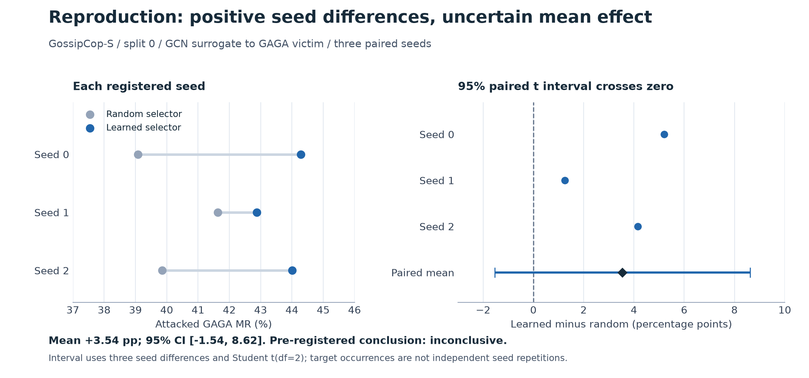
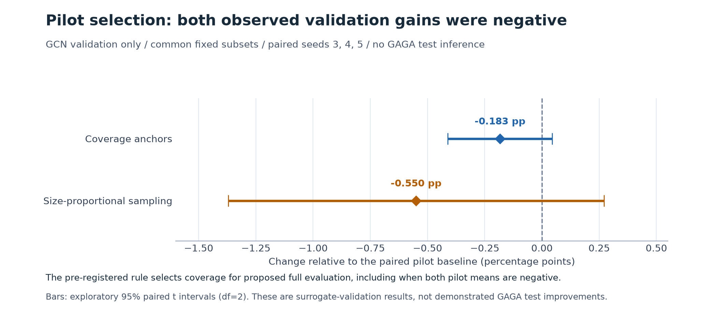
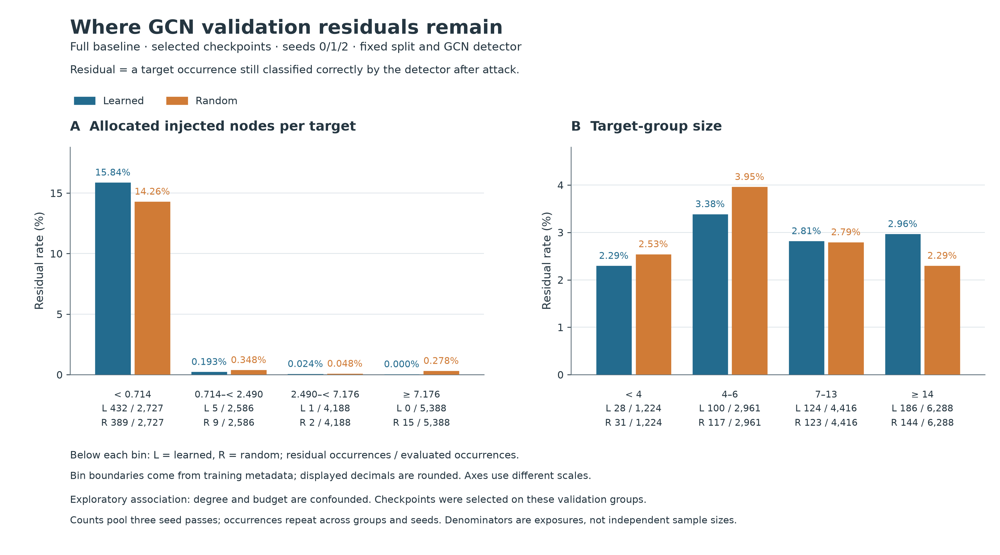

# MonTi Component Reproduction and Validation Diagnostics

CISC8006 course project report draft

Team members Junyi Tang and Yifan Fan

Evidence snapshot 31 October 2026 at public commit 21caa7531058f9149b814ae1c276ab7b654412a9

## Abstract

The frozen component comparison is **inconclusive**. On GossipCop-S split 0 with fixed GCN surrogate and GAGA victim checkpoints, separately retrained learned and random candidate selectors achieved attacked misclassification rates of 43.7280% and 40.1902%. Across three paired seeds, the mean difference was +3.5378 percentage points, with a paired 95% interval of [-1.5415, 8.6171]. The positive mean does not establish the registered claim. Two earlier improvement ideas had negative mean surrogate-validation effects. Analysis of saved outcomes then localized residual detections to low-allocation strata. Bounded endpoint and crossed-device probes identified opportunities and a paper/source scoring-role discrepancy, and clarified the limits of historical reconstruction. These exploratory findings motivate unapproved follow-up options; they establish no trained improvement or victim-transfer benefit. Twelve synthetic CPU checks prepare isolated adapters. A complete improvement/control evaluation, genuine human technical review, and course submission freeze remain unfinished. [E1, E2, E6, E8, E11, E14]

## 1 Claim and study scope

MonTi is a Transformer-based graph injection attacker that generates features and connections for multiple injected nodes. Its target groups represent coordinated frauds; the scientific question here concerns the candidate-selection component under one fixed setting, rather than all datasets or claims in the original paper. [P1, S1]

The registered claim is that learned candidate selection increases target-occurrence-weighted MR relative to a defined uniform-random selector. Higher MR indicates a stronger attack. This is a component comparison based on the official implementation with corrected flag mapping. It is not an asserted exact reconstruction of the paper's historical Table 5 procedure. Instructor approval of the proposed Component level has not been recorded. [E1]

This draft separates the frozen reproduction from later validation research. No exploratory result changes the original decision rule or baseline outputs. The owner requested that improvement ideas follow actual outcomes and subsequently requested a simple explanation before deciding on the new direction. That direction remains pending. [E13, E15]

<!-- pagebreak -->

## 2 Experimental design and evaluation

The complete official GossipCop-S graph has 16,488 nodes and 768 features. It contains 3,865,058 undirected non-self edges; the stored DGL graph has 7,746,604 directed arcs including reverse directions and self-loops. The split contains overlapping target-group occurrences, so unique nodes and evaluation occurrences differ. [E3]

| Split | Target groups | Target occurrences | All split nodes |
|---|---:|---:|---:|
| Training | 937 | 11,211 | 6,595 |
| Validation | 592 | 4,963 | 3,264 |
| Test | 909 | 10,515 | 6,629 |

The last column counts all partition nodes, including benign nodes; it is not
the union of target-group members. [E3]

Both attacker conditions were retrained for paired seeds 0, 1 and 2, with a maximum of 100 epochs and patience 10. Actual formal runs completed 11-15 epochs. The fixed setting uses GCN for surrogate training/validation, GAGA for final victim evaluation, rho=0.05, xi=0.1, K=128 and two-hop exploration. The random condition samples without replacement from the same non-target exploration pool on each training/evaluation forward; pools no larger than K are retained in full. The learned condition uses CandidateSelector. [E1, E4]

MR (%) = 100 x total incorrect target occurrences / total target occurrences.

Each overlapping node is counted within each attacked group where it occurs. MR is not conditional attack success among initially correct nodes. For groups of size 1 and 3 with error counts 1 and 0, MR is 25%, rather than the unweighted group mean of 50%. The known-answer test and actual branch checks protect this evaluation meaning. Failed graph production must fail a run rather than silently remove a group. [E1, E5]

The three run seeds are the independent replication units. The prespecified paired Student t interval uses df=2: a lower bound above zero supports the claim; an upper bound at or below zero does not support it; otherwise the result is inconclusive. Its uncertainty is conditional on this graph split and these pretrained detectors. Occurrences and overlapping groups are not extra independent seeds. [E1, E2]

The caller's candidate flag required negation to dispatch the intended selector. Both arms retain the official incidence-based budget helper, which can count shared neighbors repeatedly and differs from the paper's unique-neighbor set definition. Cache hashes, fixed detectors and source versions are recorded. These are material limits on paper equivalence, not evidence about the authors' historical execution. [E1, E3, E5]

<!-- pagebreak -->

## 3 Frozen reproduction results

All six formal runs completed and their saved predictions were independently recounted. Each evaluation contains 909 groups and 10,515 target occurrences. Clean GAGA MR is 21.6833% in all six runs. [E2, E4]

| Seed | Learned MR % | Random MR % | Paired difference pp |
|---|---:|---:|---:|
| 0 | 44.2891 | 39.0870 | +5.2021 |
| 1 | 42.8816 | 41.6262 | +1.2553 |
| 2 | 44.0133 | 39.8573 | +4.1560 |
| Mean | 43.7280 | 40.1902 | +3.5378 |
| Sample SD | 0.7459 | 1.3019 | 2.0447 |

Figure 1. Frozen baseline seed results and paired uncertainty. This existing figure is reused without changing its data or source. [E2, E16]

The paired 95% interval is [-1.5415, 8.6171] pp. Its crossing zero yields **inconclusive** under the registered rule, despite all three observed differences being positive. No seeds were added to seek significance. [E1, E2]

Paper Table 5 reports 43.70% / 39.13%, a 4.57 pp difference. The corresponding Table 4 entry is 41.34 +/- 1.90%; the discrepancy is unresolved. Corrected flag dispatch, explicitly defined random resampling, retained incidence budgets and fixed checkpoints limit historical equivalence. Numerical proximity to one table is insufficient to establish reproduction of the original procedure. [P1, E1]

<!-- pagebreak -->

## 4 Earlier technical improvement pilots

Three initial ideas concerned candidate-set coverage, sampling training groups by size, and budget-aware candidate count. Coverage anchors and size sampling were implemented and tested in nine technical pilots: a common baseline and two variants, each using seeds 3/4/5, 256 training groups, 128 validation groups, at most 10 epochs and patience 5. The validation denominator is 1,091 occurrences per run. These research pilots have no recorded instructor approval and used no GAGA test evaluation. [E6]

| Seed | Baseline MR % | Coverage MR % | Size sampling MR % |
|---|---:|---:|---:|
| 3 | 97.8002 | 97.5252 | 97.1586 |
| 4 | 97.8002 | 97.6169 | 96.9753 |
| 5 | 97.4335 | 97.3419 | 97.2502 |

Figure 2. Paired GCN validation differences in the earlier pilots. Both ideas lost against their paired baseline in every seed. This is not a final GAGA-test figure. [E6, E16]

Coverage's mean gain was -0.1833 pp, with exploratory 95% interval [-0.4110, 0.0444]; size sampling's was -0.5500 pp, with interval [-1.3709, 0.2710]. Their original rule mechanically nominated coverage even if both effects were negative. That rule and outcome remain preserved, but the owner later put the follow-up on hold and required outcome-first diagnosis. The historical nomination does not approve a new experiment or imply a positive effect. [E6, E15]

An independent audit reconciled selected validation predictions, configurations, subsets, checkpoints and costs. These completed pilots are distinct from the earlier two baseline feasibility checks and from the unapproved A/B options in Section 8. [E6, E7]

<!-- pagebreak -->

## 5 Residual detections in saved validation outcomes

Saved-outcome extraction covered 15 runs and 160 GCN validation epochs. A separate post-extraction audit checked 398 listed input hashes and 29 frozen identities. This stage performed no new inference. It describes selected validation evidence, not independent confirmation or victim-test performance. [E8]

In the learned full-baseline selected snapshots, 438 detector-correct residual occurrences remain among 14,889 seed-occurrence exposures. A residual is a target that the attacked detector still predicts correctly; it is not necessarily a clean-to-attacked transition. [E8]

| Stratum | Exposures | Residuals | Residual rate % |
|---|---:|---:|---:|
| Lowest training-derived nodes-per-target bin | 2,727 | 432 | 15.84 |
| Other bins combined | 12,162 | 6 | 0.0493 |
| All exposures | 14,889 | 438 | 2.9418 |

Figure 3. Allocation-related associations in saved validation outcomes. Bins are derived from training metadata; exposure denominators accompany residual counts. The figure is preserved from the completed descriptive analysis. [E8]

The lowest bin contains 98.63% of residuals in only 18.32% of exposures. Budget, degree and geometry overlap and are confounded; overlapping low-edge associations are not independent causal evidence. Group-size residual rates are not monotone. Selected checkpoints and late-epoch survivor effects also limit interpretation. [E8]

A post-hoc one-node/one-edge filter contains 16 of 592 validation groups and 81 occurrences per seed, giving 243 exposures and 147 historical learned residuals. Groups with identical displayed size, mean degree and budgets have different outcomes. This motivated measuring clean predictions and actual edge incidence rather than declaring budget alone causal. [E8, E9]

<!-- pagebreak -->

## 6 Bounded endpoint reconstruction

The CPU probe used the 16 one-node/one-edge validation groups and three frozen learned checkpoints: 48 group/checkpoint cases. Within each case, the reconstructed injected feature was held fixed while every legal target endpoint was enumerated, giving 243 endpoint configurations. It did not train a replacement policy or query the victim. [E9]

| Quantity | Three-seed selected-cohort value |
|---|---:|
| Clean detector-correct occurrences | 186 / 243 |
| Reconstructed attacked residuals | 148 / 243 |
| Restricted fixed-feature oracle residuals | 141 / 243 |
| Net extra incorrect occurrences | 7 |
| Cases with a strict positive opportunity | 7 / 48 |

The seven-occurrence difference is 2.8807 pp **only on this selected reconstructed cohort**. It is an optimistic endpoint oracle under fixed features, not a trained method, whole-validation gain, victim-transfer result or universal one-edge capacity bound. Twenty-two other cases have zero net changes despite gross gain/loss swaps. [E9]

An offline join shows that all seven strict CPU opportunities selected a target already misclassified by clean GCN while another clean-correct target was available. Across the enumerated configurations, new flips occurred only at the chosen direct endpoint under these fixed conditions. Group 1285 was already wrong on all four targets before attack; zero residuals there did not demonstrate four newly induced errors. These conditional findings motivate a narrow opportunity question, not a general theorem. [E10]

The first attempt failed after 79 GCN forwards because an absolute-logit agreement check was too strict despite equal classes. A separately committed amendment preserved the original attempt and required exact features, edge multisets and selected-endpoint class agreement while recording numerical differences. The complete retry used 355 forwards, for 434 total including the failure, with zero GPU-hours. An independent retained-logit recount passed. [E9]

The CPU reconstruction matched only 17/48 historical complete prediction vectors, although 41/48 residual counts agreed. There were 55/243 target-prediction disagreements. Consequently, reconstructed edges cannot be attributed to the original historical attacks. A repeat CPU reconstruction was internally consistent, which justified a separately registered device-localization study rather than blaming RNG without measurement. [E9, E11]

<!-- pagebreak -->

## 7 Score roles and crossed device replay

The paper uses the projected injected representation as an edge-score source. Frozen code stacks targets, candidates and injected nodes, but indexes the full projected sequence with injected-relative row indices. All 96 runtime captures therefore used the first target slot when one node was injected. The later physical edge originates from the injected node correctly; it does not repair the earlier representation index. Transformer mixing still carries context. This establishes a formulation/source discrepancy, not author intent or a beneficial correction. [P1, E11, E12]

| Generator | GCN device | Residuals / 243 | Historical vector matches |
|---|---|---:|---:|
| CPU | CPU | 148 | 17 / 48 |
| CPU | GPU | 148 | 17 / 48 |
| GPU | CPU | 147 | 48 / 48 |
| GPU | GPU | 147 | 48 / 48 |

For each captured attack, changing detector device caused zero class disagreements, although logits differed by up to 5.53e-5. Under these conditions, class differences localize to generation. Historical graphs/features were not retained, so GPU prediction concordance is not identity of the original perturbations. [E11]

Actual raw maxima tied in 58/96 captures; target probabilities tied at the maximum in 63/96. Identical-vector top-k reference choices differed across devices in 32/96, all on exact ties. However, naturally generated CPU/GPU probability vectors matched in 0/48 pairs; endpoints differed in 35/48 and candidate sets/order in 36/48. Final top-k alone is not a demonstrated cause of all generator differences. The paper-role raw mathematical reference on old weights still tied in 36/96 and was never used for an evaluated attack. [E11]

GPU reconstruction spent the sole edge on nine already clean-wrong targets: three all-clean-wrong cases and six with a clean-correct alternative. These six opportunities, rather than the CPU seven, motivate the GPU-path proposal. They are not demonstrated gains from a mask. [E11]

The complete matrix contains 96 generator forwards, 224 GCN forwards and 192 algebra-only references. A zero-forward startup failure and metadata checks are preserved. A separate amendment resolved the locked runtime's CUDA-visibility mismatch. Conservative forensic cost is 0.060797 aggregate GPU-hours, below its registered 0.1-hour ceiling; an independent retained-tensor recount passed. [E11]

<!-- pagebreak -->

## 8 Unapproved follow up options

The owner has requested an accessible explanation before selecting a direction. Neither A nor B is approved, and no v2 trained model or real-data correction result exists. The earlier coverage follow-up remains on hold. [E13, E15]

| Option | Proposed change | Necessary interpretation or control |
|---|---|---|
| A Source role alignment | Score using the injected slot T+C+src and retrain consistently | Compare fresh matched native and aligned training; an old-weight substitution is only an ablation |
| B Sole edge priority | For one-node/one-edge groups, choose among clean-surrogate predicted-fraud targets, falling back to all targets if none qualify | Hold features/budgets fixed; compare native, all-target procedural and random count-matched masks |
| C Exact tie policy | Break exact mandatory-target ties by global node ID | Separate reproducibility control; no promise of whole-generator device identity or MR gain |

B uses surrogate predictions available to the attacker under the known target-fraud assumption. It must not use victim outcomes or evaluation-label oracle choices. Its extra clean-surrogate queries and cost require explicit accounting and fair information controls. A targets a formulation discrepancy; B tests scarce-budget allocation. Neither is established first-in-literature novelty. [E13]

The draft pilot proposes fresh native/A training for seeds 3/4/5, 256 training groups and GCN validation only, with a maximum of 2 aggregate GPU-hours. B would share the new native checkpoints and captured features/scores. Exact cohorts, RNG isolation, checkpoint draws, query accounting, limits and progression rules remain blocking choices before any freeze. Proposed thresholds are not already adopted rules. Full GAGA testing retains a separate owner checkpoint. [E14]

Isolated adapters passed 12 synthetic CPU test methods from clean committed source cc24bbc. These include 48 comparisons of default outputs, gradients, random states and budget mutation with the frozen method. A separate known-answer example covers nonzero candidate counts and multiple injected nodes. No datasets, saved checkpoints, detector queries, optimizer steps, training or GPU work were used. Agent source reviews are disclosed; these checks are functional preparation, not real-data efficacy or human verification. [E14]

The required full improvement and mechanism-control result is **not executed**. It cannot be filled with small-pilot scores, endpoint-oracle headroom or synthetic-check success. A null or negative full study can still answer a defined question, but its scope and protocol must be confirmed before execution. [E19]

<!-- pagebreak -->

## 9 Reproducibility costs and completion status

The baseline freeze predates formal registration: 28 October 2026 at 12:25:57 UTC, followed by the first registration at 12:26:17. Original execution commit 9f782df is preserved truthfully and mapped to an equivalent English public snapshot. Public documentation/history are English; original execution records remain privately archived. No claim is made about erasing independent clones or caches. [E1, E4, E17]

Each reported run links its commit, configuration, command, seed, environment, elapsed time, cost, checkpoint checksum and saved output. Large data/models and original node-level predictions remain outside Git with hashes. The locked ML runtime is Python 3.8.20, Torch 1.13.1+cu117 and DGL 1.1.2+cu117. A fresh installation has not been independently verified. Sources and asset checksums are recorded; the upstream code licence must not be assumed to license all data/model assets. [E3, E4, E5]

| Accounting scope | GPU wall hours |
|---|---:|
| Six formal baseline runner records | 2.692921 |
| Baseline feasibility pilots separately | 0.056357 |
| Baseline queue accounting including boundaries/pilots | 2.759076 |
| Additional research measured or conservatively charged | 0.775006 |
| Additional setup reserve not measured usage | 0.020000 |
| Remaining additional allowance after reserve | 11.204994 |

The baseline rows are alternative/nested scopes, not quantities to sum. Maximum formal reserved memory is approximately 3.65 GiB. Additional research is capped at 12 aggregate GPU-hours; the proposed new pilot is not permission to launch. Shared hardware affects timings, so these are descriptive costs rather than efficiency replication. Monetary price is unavailable. Failures and amendments remain visible. [E4, E11, E15]

AI assistance spans paper/protocol understanding, implementation/testing and improvement analysis. One authorized DeepSeek review consumed 1,035 tokens; its public English record is a labeled translation, with actual usage and critical review retained. This report was prepared with Codex and agent source reviews. Such reviews do not establish completed human verification or either member's actual contribution. [E18]

Course approval of scope/ideas, genuine technical human checks, an individual accept/change/reject case, actual contributions, full improvement/control evaluation, final slides, rehearsal, defense and final tag remain pending as applicable. Approximate 50/50 responsibilities are plans. The owner's 5 November technical target is separate from the unprovided UMMoodle format and common Week 12 freeze. This draft is not a final course submission. [E19, E20]

## 10 Conclusion

The registered learned-versus-random claim remains inconclusive. Negative pilots and bounded validation diagnostics narrow the next questions without establishing a successful remedy. Further claims require the confirmed intervention, frozen controlled evaluation and genuine team verification that are currently absent.

<!-- pagebreak -->

## References and evidence index

Numerical evidence and figures refer to public snapshot 21caa7531058f9149b814ae1c276ab7b654412a9. Original execution identities are preserved through the mapping. The editable source and build manifest accompany this draft; the draft adds no experimental observations.

- [P1 Choi et al 2025 MonTi paper](https://ojs.aaai.org/index.php/AAAI/article/view/33760). Unveiling the Threat of Fraud Gangs to Graph Neural Networks: Multi-Target Graph Injection Attacks Against GNN-Based Fraud Detectors. AAAI 39(15), 16028-16036. DOI 10.1609/aaai.v39i15.33760. Tables 4/5 and printed page 16031.
- [S1 Official implementation](https://github.com/bdi-lab/MonTi/tree/10f233e953679ec3715125dc058ef6d28bee4691). Upstream revision 10f233e; attribution and licence retained.
- [E1 Frozen baseline protocol](../course/frozen_protocol.json) and [configuration](../course/configs/baseline.json).
- [E2 Baseline seed summary](../evidence/reproduction_summary.json) and [independent prediction recount](../evidence/baseline_audit.json).
- [E3 Partition and asset audit](../evidence/data/partition_audit.json), [input hashes](../evidence/data/input_manifest.json) and [official asset records](../evidence/bootstrap/selected_assets.json).
- [E4 Baseline run registry](../evidence/run_registry.json) and [queue events](../evidence/queue_events.jsonl).
- [E5 Evaluation tests](../course/test_protocol.py), [runtime](../environment/runtime.json), [package lock](../environment/pip-freeze.txt) and [historical methods discussion](../course/PROTOCOL.md).
- [E6 Earlier pilot outcomes](../evidence/improvement_pilot_summary.json), [protocol](../course/improvements/pilot_protocol_v1.json) and [three initial ideas](../course/IMPROVEMENT_PROPOSAL.md).
- [E7 Earlier pilot independent audit](../evidence/improvement_pilot_audit.json).
- [E8 Saved-outcome report](RESULTS_FIRST_DIAGNOSIS.md), [tables](../evidence/results_first_diagnosis_v1/) and [audit](../evidence/results_first_diagnosis_audit_v1.json).
- [E9 Endpoint report](ONE_EDGE_DIAGNOSIS.md), [complete retry](../evidence/one_edge_diagnosis_v2/), [failed attempt](../evidence/one_edge_diagnosis_v1/) and [audit](../evidence/one_edge_diagnosis_audit_v2.json).
- [E10 Offline clean-endpoint attribution](../evidence/one_edge_endpoint_attribution_v1.json).
- [E11 Crossed replay report](SCORE_ROLE_REPLAY.md), [raw-derived matrix](../evidence/score_role_replay_v2/), [audit](../evidence/score_role_replay_audit_v2.json) and [ledger-adjusted recount](../evidence/score_role_replay_recount_after_ledger_update.json).
- [E12 Paper and source role comparison](../course/PAPER_EDGE_SCORE_CHECK.md).
- [E13 Outcome-based proposal v2](../course/IMPROVEMENT_PROPOSAL_V2.md).
- [E14 Unapproved pilot draft](../course/outcome_v2/PILOT_PROTOCOL_DRAFT.md), [synthetic record](../evidence/outcome_v2_synthetic_checks/attempt1.json) and [execution/review receipt](../evidence/outcome_v2_synthetic_checks/review_and_receipt.json).
- [E15 Project checkpoint](../course/PROJECT_STATUS.json) and [additional research cost ledger](../evidence/research_cost_ledger.json).
- [E16 Existing figure provenance](figures/figure_provenance.json) and [results-first figure provenance](figures/results_first/provenance.json).
- [E17 Publication history mapping](../evidence/publication_history_map.json).
- [E18 AI use record](../AI_USAGE.md), [DeepSeek English translation](../evidence/agent_reviews/deepseek_protocol_review.en.json) and [usage supplement](../evidence/agent_reviews/deepseek_usage_record.md).
- [E19 Supplied course guide](../evidence/course-guide.txt) and [grading audit](../course/GRADING_AUDIT.md). Final UMMoodle rules take precedence when provided.
- [E20 Human review template](HUMAN_REVIEW.md), [contribution record](../CONTRIBUTIONS.md) and [offline demo script](DEMO_SCRIPT.md). Preparation is not proof of human completion.
